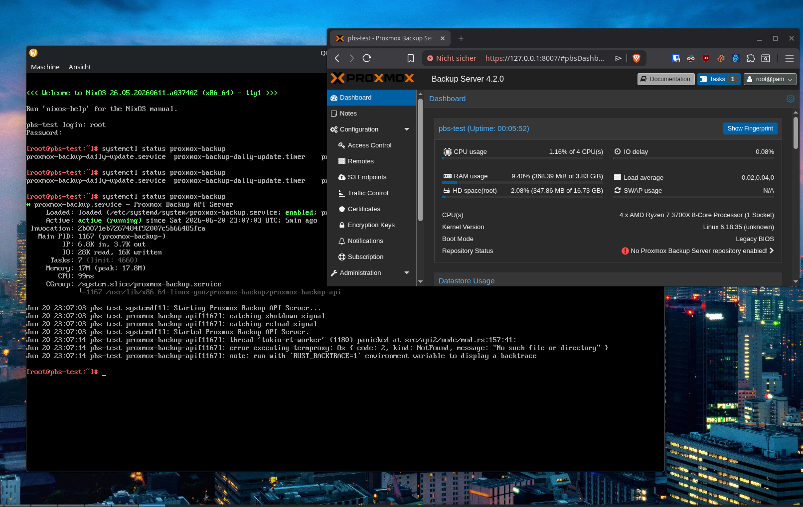

# Proxmox Backup Server for NixOS

[](https://github.com/AWildLeon/nixos-pbs/actions/workflows/build.yml)

A native Nix package and NixOS module for [Proxmox Backup Server](https://pbs.proxmox.com/)
(PBS). It is a regular Nix derivation running as systemd services. There is no Debian
container and no `dpkg` runtime.



- Built from the upstream Proxmox git sources, sharing the source set and Cargo lock basis
  of nixpkgs' `proxmox-backup-client`.
- The web UI is assembled from the official Proxmox `.deb` assets. Features that make no
  sense on NixOS (APT, disk/network management, shell, reboot) are trimmed out.
- Datastores and prune/verify/sync jobs can be declared in Nix.
- Prebuilt binaries for `x86_64-linux` and `aarch64-linux` on Cachix.
- An end-to-end NixOS VM test (backup → restore → verify → GC) runs in CI.
- An automated workflow keeps the package on the latest PBS release.

Upstreaming to nixpkgs: [NixOS/nixpkgs#543254](https://github.com/NixOS/nixpkgs/pull/543254)

> [!WARNING]
> This is an **unofficial** port. It is **not** supported by Proxmox Server Solutions GmbH,
> so do not contact Proxmox support about it. The web UI carries a banner saying so.
> Report problems on the [issue tracker](../../issues).

## Contents

- [Quick start](#quick-start)
- [Binary cache](#binary-cache)
- [Configuration](#configuration)
- [Datastore paths](#datastore-paths)
- [Try it in a VM](#try-it-in-a-vm)
- [How it works](#how-it-works)
- [Development](#development)
- [Status & limitations](#status--limitations)
- [License](#license)

## Quick start

### With flakes

```nix
{
  inputs.pbs.url = "github:AWildLeon/nixos-pbs";

  outputs = { self, nixpkgs, pbs, ... }: {
    nixosConfigurations.host = nixpkgs.lib.nixosSystem {
      system = "x86_64-linux";
      modules = [
        pbs.nixosModules.proxmox-backup-server
        {
          nixpkgs.overlays = [ pbs.overlays.default ];

          services.proxmox-backup-server = {
            enable = true;
            openFirewall = true;
          };
        }
      ];
    };
  };
}
```

### Without flakes

`default.nix` / `shell.nix` expose the same outputs through
[flake-compat](https://github.com/NixOS/flake-compat):

```nix
{ ... }:
let
  pbs = import (fetchTarball {
    url = "https://github.com/AWildLeon/nixos-pbs/archive/main.tar.gz";
    # sha256 = "..."; # pin for reproducibility
  });
in
{
  imports = [ pbs.nixosModules.proxmox-backup-server ];
  nixpkgs.overlays = [ pbs.overlays.default ];

  services.proxmox-backup-server = {
    enable = true;
    openFirewall = true;
  };
}
```

### First login

After `nixos-rebuild switch`, open `https://<host>:8007/` and log in as `root@pam` with the
host's root password. Authentication goes through PAM, so any local user works once you
grant them permissions in PBS.

The usual CLI tools (`proxmox-backup-manager`, `proxmox-tape`, …) are on `$PATH`:

```sh
proxmox-backup-manager datastore create main /var/lib/proxmox-backup/datastores/main
```

Documentation for this port, plus the full upstream manual, is served by the web UI at
`/docs`.

## Binary cache

CI pushes prebuilt packages to Cachix. Add it to your configuration:

```nix
{
  nix.settings = {
    substituters = [ "https://awildleon-nixos-pbs.cachix.org" ];
    trusted-public-keys = [
      "awildleon-nixos-pbs.cachix.org-1:4kEEBSONGJ0F7Ita/3ZRcTWaR6M7YHXhltJaoEYl3ew="
    ];
  };
}
```

Or for a single command:

```sh
nix build github:AWildLeon/nixos-pbs \
  --extra-substituters https://awildleon-nixos-pbs.cachix.org \
  --extra-trusted-public-keys awildleon-nixos-pbs.cachix.org-1:4kEEBSONGJ0F7Ita/3ZRcTWaR6M7YHXhltJaoEYl3ew=
```

## Configuration

### Options

All options live under `services.proxmox-backup-server`.

| Option              | Type                | Default                          | Description                                            |
| ------------------- | ------------------- | -------------------------------- | ------------------------------------------------------ |
| `enable`            | bool                | `false`                          | Enable Proxmox Backup Server.                          |
| `package`           | package             | `pkgs.proxmox-backup-server-fhs` | The PBS package to use.                                |
| `openFirewall`      | bool                | `false`                          | Open TCP port `8007` for the web UI/API.               |
| `sslCertificate`    | null or path        | `null`                           | PEM certificate (chain). `null` = self-signed.         |
| `sslCertificateKey` | null or path        | `null`                           | PEM private key matching `sslCertificate`.             |
| `ensureDatastores`  | attrs of submodules | `{ }`                            | Datastores to create/update on activation.             |
| `ensurePruneJobs`   | attrs of submodules | `{ }`                            | Prune jobs to create/update on activation.             |
| `ensureVerifyJobs`  | attrs of submodules | `{ }`                            | Verification jobs to create/update on activation.      |
| `ensureSyncJobs`    | attrs of submodules | `{ }`                            | Sync jobs to create/update on activation.              |

The module creates the `proxmox-backup-server` user and group, the state, cache and log
directories, PAM integration, the `proxmox-backup` and `proxmox-backup-proxy` systemd units,
and the daily-update timer.

### Declarative datastores and jobs

On activation, the `proxmox-backup-setup` oneshot service reconciles declared resources
through `proxmox-backup-manager`. Each one is **created if missing and updated to match**
if it exists. Anything created in the UI and not declared here is left alone. Nothing is
ever deleted.

```nix
services.proxmox-backup-server = {
  enable = true;
  openFirewall = true;

  ensureDatastores.main = {
    path = "/mnt/backup/main";   # parent must exist, e.g. a `fileSystems` mount
    comment = "Primary store";
    gcSchedule = "daily";
  };

  ensurePruneJobs.main-prune = {
    datastore = "main";
    schedule = "daily";
    settings = { keep-daily = 7; keep-weekly = 4; };
  };

  ensureVerifyJobs.main-verify = {
    datastore = "main";
    schedule = "sun 02:00";
  };
};
```

Each submodule has a few first-class options (`path` / `datastore`, `comment`,
`gcSchedule`, `schedule`, `disable`). It also has a freeform `settings` attrset for any
other PBS flag. Keys use PBS's kebab-case spelling (`keep-daily`) and map to
`--<key> <value>`.

Remotes are not managed yet. A sync job that pulls from a remote needs that remote created
in the UI first. If a job references a datastore not declared in `ensureDatastores`, you get
an evaluation warning and the datastore is assumed to be managed externally.

### Custom TLS certificate

PBS generates a self-signed certificate on first start. To use your own:

```nix
services.proxmox-backup-server = {
  sslCertificate = "/run/secrets/pbs/cert.pem";
  sslCertificateKey = config.age.secrets.pbsKey.path;
};
```

Before the daemons start, both files are **copied** to `/etc/proxmox-backup/proxy.{pem,key}`.
When the source files change, the daemons restart and pick up the new copies, so renewed
certificates are applied on the next switch. Unset both options to go back to self-signed.
Set both or neither: setting only one fails an assertion.

Keep the key out of the world-readable Nix store. Point at a path from agenix, sops-nix or
similar.

## Datastore paths

The daemons run inside an FHS sandbox (see [How it works](#how-it-works)), which
bind-mounts **every top-level host directory** at its normal path, submounts included.
Datastores in the usual places work as-is:

- `/var/...`, including the default `/var/lib/proxmox-backup/datastores/...`
- `/mnt/...`, `/media/...`, `/srv/...`, `/opt/...`, `/home/...`, `/root/...`
- any custom top-level mount, such as a ZFS pool at `/tank` or a disk at `/data`

Only directories the sandbox owns are excluded: `/usr`, `/bin`, `/sbin`, `/lib*`,
`/libexec`, `/nix`, `/dev`, `/proc`, `/etc`.

The **bare root `/`** is the exception. The sandbox root is a throwaway namespace, so a
datastore placed directly under `/` silently disappears. For that case the real host root
is also bound at **`/hostsys`**:

```sh
proxmox-backup-manager datastore create root /hostsys/subdir
```

> [!NOTE]
> Binds are set up when the daemons start. A filesystem mounted *after* PBS is running
> stays invisible until you restart the services. Declarative `fileSystems` mounts are fine.

> [!WARNING]
> `/hostsys` exposes the entire host filesystem read-write to the PBS daemons, and
> `proxmox-backup-api` runs as root.

## Try it in a VM

The flake includes a throwaway `pbs-test-vm` configuration:

```sh
./scripts/run-vm.sh
```

State lives in `./.vm-state/` (gitignored), so the system disk and a blank 20 GiB datastore
disk (`/dev/vdb`) persist across reboots. Delete that directory to start fresh.

| Service       | Address                                      |
| ------------- | -------------------------------------------- |
| PBS web / API | <https://localhost:8007/> (self-signed cert) |
| SSH           | `ssh -p 2222 root@localhost`                 |

The root password is `nixos`, and the web UI login is `root@pam` with that password.

## How it works

PBS is built with `rustPlatform.buildRustPackage` from the upstream repos (`proxmox-backup`,
`proxmox`, `proxmox-fuse`, `pxar`, `pathpatterns`). A small cargo patch re-routes
dependencies that aren't on crates.io. The web UI is unpacked from the official `.deb`
assets, the ExtJS bundle is concatenated from the upstream `Makefile` file list, and
features that don't apply to NixOS are removed: the xterm.js shell, APT
updates/repositories, disk/ZFS management, network/time config and the reboot/shutdown
buttons.

PBS hardcodes Debian-style paths (`/usr/share/javascript/proxmox-backup`,
`/usr/lib/<multiarch>/proxmox-backup`, `/usr/bin/ip`, …), so the package is split in two,
like `steam` / `steam-run` in nixpkgs:

- **`proxmox-backup-server`** is the base build, using the normal Nix layout
  (`$out/{bin,lib,share}`). It is not run directly.
- **`proxmox-backup-server-fhs`** wraps each binary in a
  [`buildFHSEnv`](https://nixos.org/manual/nixpkgs/stable/#sec-fhs-environments). It maps the
  base package onto `/usr` and bind-mounts the host's `/run` and `/var`. It also provides a
  private `/etc` that links the host's `passwd`, `group`, `shadow`, `pam.d` and `ssl`, so PAM
  and TLS work, with `/etc/proxmox-backup` bound in on top.

The systemd units and the CLIs on `$PATH` all come from the `-fhs` package, so the module
itself needs no bind-mount plumbing.

## Development

```sh
nix build .#proxmox-backup-server-fhs        # runnable, FHS-wrapped (default)
nix build .#proxmox-backup-server            # base build only
nix build .#checks.x86_64-linux.integration  # end-to-end VM test
nix run .#update                             # bump to the latest PBS release
./scripts/dev-loop.sh                        # auto-rebuilding clean-slate VM loop
```

`nix run .#update` refreshes `sources.json` (git pins and web assets) and regenerates
`Cargo.lock`. A weekly GitHub workflow runs it and opens a PR, and Dependabot handles
`flake.lock` and Actions bumps.

```
flake.nix                          # packages, overlay, module, checks, test VM, update app
default.nix / shell.nix            # non-flake entry points (flake-compat)
overlay.nix                        # nixpkgs overlay
modules/proxmox-backup-server.nix  # services.proxmox-backup-server
pkgs/proxmox-backup-server/
  package.nix                      # base build
  sources.json                     # pinned upstream git + .deb sources
  update.sh                        # updater behind `nix run .#update`
  Cargo.lock                       # pinned Rust dependency lock
  0001-cargo-re-route-…patch       # cargo source re-routing
  www/                             # web UI replacements and transform scripts
  docs/                            # port docs served at /docs
pkgs/proxmox-backup-server-fhs/
  package.nix                      # buildFHSEnv wrapper
tests/integration.nix              # NixOS VM test
scripts/                           # run-vm.sh, dev-loop.sh
```

## Status & limitations

The standard feature set (local datastores, backup, restore, sync, verify, prune, GC, PAM login, docs,
declarative config) has been in real-world use for months without issues. Some areas are
not actively used and may have untested edge cases:

- **S3-backed datastores** have not been exercised on this port.
- Generated manpages.
- Assumptions that only hold on Debian-style hosts.
- **Tape backup is untested and likely does not work.** The tooling (`proxmox-tape`,
  `pmt`, `pmtx`, `sg-tape-cmd`) is built and the UI is left in place, but nobody has tried
  it on this port. If you need tape, please open an issue.

If something is missing or broken, please [open an issue](../../issues/new) with logs and
steps to reproduce.

### Roadmap

- [x] NixOS VM tests
- [x] Real-world testing
- [x] Gather feedback
- [ ] Resolve the Proxmox trademark question
- [ ] Upstream to nixpkgs ([#543254](https://github.com/NixOS/nixpkgs/pull/543254))

## License

The packaging in this repository (Nix expressions, module, scripts, docs) is licensed under
**MIT**. See [`LICENSE`](LICENSE).

**Proxmox Backup Server itself remains AGPL-3.0-only.** The MIT license does not relicense
it. It also might not apply to patches included here, which may be derivative works of the
software they patch. Those are covered by the respective upstream licenses.

Proxmox® is a registered trademark of Proxmox Server Solutions GmbH. This is an
independent packaging effort and is not affiliated with or endorsed by Proxmox.

## Notes

Large parts of this were written with Claude Code. I've reviewed everything, corrected
where needed, and understand every line of it. That said: there may be dragons.
